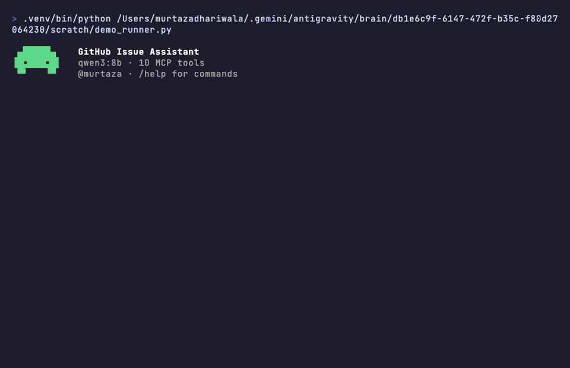
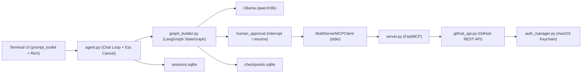

# GitHub Issue Assistant

A conversational AI assistant and standalone **GitHub MCP Server** built with **LangGraph**, **Ollama (`qwen3:8b`)**, and **FastMCP**.

The project consists of two independently usable components:
1. **GitHub MCP Server (`server.py`)** — exposes GitHub read and write operations as reusable MCP tools over `stdio` (usable by Claude Desktop, VS Code, Cursor, or any MCP client).
2. **Terminal Assistant (`agent.py`)** — a local LangGraph agent with persistent SQLite memory, context compaction (`/compact`), macOS Keychain authentication (`/login`), and human-in-the-loop approval for write actions.

---

## Demo



---

## Architecture



---

## Features

- **10 GitHub MCP Tools**
  - *Read-only:* `get_issues` (paginated up to 1,000 open items, excluding PRs), `list_repos`, `get_issue_details`, `get_issue_comments`, `get_repository`, `search_issues`, `list_pull_requests`
  - *Write (approval-gated in the agent):* `create_issue`, `add_issue_comment`, `update_issue`
- **Human-in-the-Loop Approval:** Write tools pause via LangGraph `interrupt()` in `graph_builder.py` and require explicit `y/n` confirmation before execution (`Command(resume=...)`).
- **Context Compaction (`/compact`):** Summarises older turns while preserving system instructions, tool-call boundaries, and recent turns.
- **Persistent Sessions:** Separate SQLite databases for LangGraph checkpoints (`checkpoints.sqlite`) and session metadata (`sessions.sqlite`), with auto-generated titles.
- **Secure Authentication (`/login`, `/logout`):** Stores GitHub Personal Access Tokens in **macOS Keychain** via `/usr/bin/security` — never printed or stored in Git. Falls back to the `GITHUB_TOKEN` environment variable for `server.py` on non-macOS systems.
- **Interactive Terminal UX:** Inline command autocomplete, `Esc`-to-cancel in-flight requests, live tool-usage indicators, and Rich Markdown rendering.

---

## Setup

### Prerequisites
- **macOS** (for the terminal assistant, which uses macOS Keychain and Unix `termios`/`tty` APIs) with Python 3.12+
  - *Note:* The standalone MCP server (`server.py`) can also run on Linux/other platforms using the `GITHUB_TOKEN` environment variable.
- [Ollama](https://ollama.com/) running locally with `qwen3:8b`:
  ```bash
  ollama pull qwen3:8b
  ```

### Installation
```bash
python3 -m venv .venv
source .venv/bin/activate
pip install -r requirements.txt
```

### Run the Assistant
```bash
python agent.py
```

### Configuration (Optional Environment Variables)
| Variable | Default | Description |
|---|---|---|
| `OLLAMA_MODEL` | `qwen3:8b` | Local Ollama model name |
| `OLLAMA_TEMPERATURE` | `0` | Sampling temperature |
| `KEEP_RECENT_TURNS` | `2` | Recent turns preserved by `/compact` |
| `CHECKPOINTS_DB_PATH` | `./checkpoints.sqlite` | LangGraph checkpoint database path |
| `SESSIONS_DB_PATH` | `./sessions.sqlite` | Session metadata database path |
| `GITHUB_API_TIMEOUT` | `15` | Timeout (seconds) for GitHub API requests |
| `GITHUB_TOKEN` | *(unset)* | Optional fallback GitHub token when macOS Keychain is unavailable |

---

## Slash Commands

| Command | Description |
|---|---|
| `/help` | Show available commands |
| `/login` | Store a GitHub Personal Access Token in macOS Keychain |
| `/logout` | Remove stored GitHub credentials |
| `/tools` | List loaded MCP tools |
| `/compact` | Summarise older conversation history |
| `/clear` | Clear current conversation history |
| `/new` | Start a new conversation |
| `/sessions` | List saved conversations |
| `/switch` | Switch to another saved conversation |
| `/rename <title>` | Rename the current conversation |
| `/delete` | Delete a saved conversation |
| `/exit` | Exit the assistant |

---

## Using the MCP Server in Other Clients (Interoperability)

`server.py` has zero dependencies on LangGraph or Ollama and communicates over `stdio`.
Note that the Human-in-the-Loop approval gate lives in the LangGraph agent (`graph_builder.py`), so external MCP clients (such as Claude Desktop or VS Code) rely on their own built-in tool confirmation prompts rather than receiving an approval gate from `server.py`. On non-macOS hosts, set `GITHUB_TOKEN` in the server's `env` block.

### Claude Desktop (`~/Library/Application Support/Claude/claude_desktop_config.json`)
```json
{
  "mcpServers": {
    "github-issue-assistant": {
      "command": "/path/to/github-issue-assistant/.venv/bin/python",
      "args": [
        "/path/to/github-issue-assistant/server.py"
      ]
    }
  }
}
```

### VS Code (`.vscode/mcp.json`)
```json
{
  "servers": {
    "github-issue-assistant": {
      "type": "stdio",
      "command": "/path/to/github-issue-assistant/.venv/bin/python",
      "args": [
        "/path/to/github-issue-assistant/server.py"
      ]
    }
  }
}
```

---

## Running Tests
```bash
python -m pytest -v -p no:langsmith
```